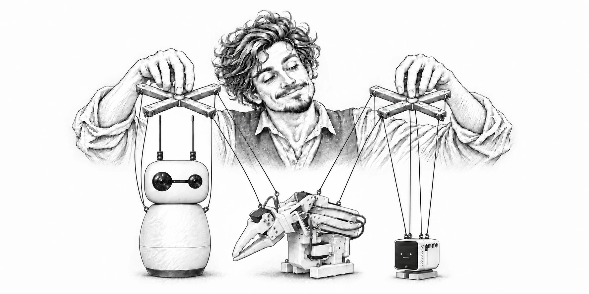

# Forge Puppeteer

**One MCP interface for agentic control of popular open-source robots.**

Forge Puppeteer gives AI agents a standard [Model Context Protocol (MCP)](https://modelcontextprotocol.io/) interface for interacting with robots through tool calls. It exposes supported native device capabilities alongside shared behaviors, actions, and emotions for conversational robots: an agent can request listening, speaking, acknowledgement, gestures, or an expression, and each configured performer interprets the request through its own capabilities.

The project takes inspiration from [Reachy Mini](https://github.com/pollen-robotics/reachy_mini) and the [Reachy Mini Conversation App](https://github.com/pollen-robotics/reachy_mini_conversation_app), extending the idea of an expressive conversational robot toward a general approach for multiple kinds of robots and agents. Puppeteer also supports scripted performances, Python, and CLI workflows.

**One language for expression. Many robots. Live conversations and scripted performances.**

## What you can do

- Give a conversational character a physical presence through listening, speaking, idle, acknowledgement and gesture behaviors.
- Coordinate a shared semantic performance across Reachy Mini, StackChan and SO-ARM101, with each performer using its supported capabilities.
- Author repeatable behavior packs and scripted performances with validation, timing and action records.
- Use MCP tool calls to discover supported capabilities and request operator-authorized native controls and shared expressions. Available tools vary by device, configuration, and MCP server.
- Experiment without robots using mock stages and fake providers.

The ensemble launcher supports configurations for Reachy alone, Reachy with StackChan, or all three performers. Actual capabilities depend on the configured providers, operator grants and device readiness. See [Native conversational performers](docs/THREE_ROBOT_ENSEMBLE.md).

## How it works

A conversation system, working agent or scripted director requests a semantic behavior. Puppeteer coordinates the performers, validates and journals actions, and delegates execution through device adapters. Each robot's SDK or broker retains authority over calibration, motion limits, leases and stopping. Puppeteer can work independently of the broader AgenticForge platform.

Puppeteer is a performance layer: the conversation application owns its voice and personality, and a robot's controller remains responsible for physical operation. Acknowledging an instruction does not mean a task is complete.

## Try it without hardware

Requires Python 3.11 or newer. From a local checkout:

```bash
git clone https://github.com/AgenticForge-Labs/forge-puppeteer.git
cd forge-puppeteer
python -m pip install -e '.[mcp,dev]'

# Validate and execute a mock physical shot
forge-puppeteer validate --request examples/robots/package-smoke-request.json
forge-puppeteer execute \
  --request examples/robots/package-smoke-request.json \
  --stage mock --out /tmp/forge-puppeteer-take.json

# Run a fake Reachy behavior handoff
python scripts/downstream-integration-smoke.py
```

To connect an MCP client to a fake StackChan server:

```bash
forge-puppeteer-mcp --config examples/robots/mock-mcp-server.json
```

The server communicates over **stdio**; it must be launched by an MCP client rather than used as an interactive shell. These examples use mock or fake providers.

## Working with real devices

Real hardware requires operator-reviewed configuration, device-specific permissions and appropriate safety checks. Software tests and simulations do not qualify physical motion or establish that a device has safely stopped. Start with the [robot deployment and safety guide](docs/ROBOT_DEPLOYMENT.md) and the relevant [ensemble guide](docs/THREE_ROBOT_ENSEMBLE.md).

## Robot SDKs

Puppeteer coordinates semantic performance through device-specific controls. These SDKs are also useful independently:

- [SO-ARM101 Motion SDK](https://github.com/AgenticForge-Labs/soarm101-motion-sdk) — calibration, motion, teaching, GUI, simulation and the arm's trusted control boundary.
- [StackChan Control SDK](https://github.com/AgenticForge-Labs/stackchan-control-sdk) — native head, face and lighting controls, protocols and companion firmware.

## Built on a community of open robotics

Thanks to the projects and communities making these robots and tools possible:

- [Pollen Robotics Reachy Mini SDK](https://github.com/pollen-robotics/reachy_mini), [Reachy Mini Conversation App](https://github.com/pollen-robotics/reachy_mini_conversation_app), and [Reachy Mini emotions library](https://huggingface.co/datasets/pollen-robotics/reachy-mini-emotions-library) — expressive robotics and recorded behaviors that inspire this project.
- [The Robot Studio's SO-ARM project](https://github.com/TheRobotStudio/SO-ARM100) and [Hugging Face LeRobot](https://github.com/huggingface/lerobot) — the SO-101 open robot arm and broader open robotics ecosystem.
- [Stack-chan](https://github.com/stack-chan/stack-chan) and [M5Stack StackChan](https://github.com/m5stack/StackChan) — the desktop robot community and firmware.
- [Model Context Protocol](https://modelcontextprotocol.io/) — the common tool interface connecting agents and applications.

## Explore

- [Current status](STATUS.md) and [development plan](PLAN.md)
- [Robot contracts and capability models](docs/ROBOT_CONTRACTS.md)
- [Native conversational behaviors](docs/NATIVE_CONVERSATION_BEHAVIORS.md)
- [StackChan MCP integration](docs/STACKCHAN_NATIVE_MCP.md)
- [Forge Studios and Reachy handoff examples](docs/DOWNSTREAM_INTEGRATIONS.md)
- Example behavior packs: [Reachy](examples/robots/reachy/), [StackChan](examples/robots/stackchan/), [SO-ARM101](examples/robots/soarm101/)

## Project status and license

Forge Puppeteer is in active development. Hardware qualification and integration work are ongoing; see [STATUS.md](STATUS.md) for details.

AgenticForge Labs-authored code is licensed under the [Apache License 2.0](LICENSE). Third-party dependencies, datasets, recordings, and other externally sourced materials retain their respective licenses and attribution requirements.
